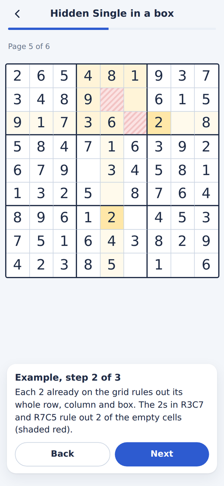

# Sudoku Dojo

Free sudoku with no ads, built for getting better. Never played before? The app teaches you from the rules up to expert techniques, one lesson at a time. Already fast? Play on "paper", where nothing tells you if a digit is right until the grid is full, and train the exact techniques that slow you down.

**Play now: [thomas-f17.github.io/sudoku-dojo-web](https://thomas-f17.github.io/sudoku-dojo-web/)**

  
  
  
  

## Install it

It runs in the browser, but works best installed. It then opens full screen, works with no internet connection, and your progress is kept safe.

- **iPhone or iPad:** open the link in **Safari**, tap **Share**, then **Add to Home Screen**. Do this before you start playing: on iPhone, Safari and the Home Screen app keep separate progress, and Safari may clear a site's data if you don't visit for a week or so.
- **Android:** open the link in Chrome, tap **Install** on the card that appears (or menu ⋮ → **Add to Home screen**).
- **Computer:** just play in the browser. In Chrome or Edge you can also install it from the icon in the address bar.

## New to sudoku? Start here

Open the **Train** tab and tap **Lesson: How sudoku works** at the top of the Easy belt (new players also see a "Start with the basics" button on the home screen). It explains the rules, the grid and the words the app uses, in a few minutes. Then follow the belt from top to bottom: each lesson teaches one method, and the drill after it lets you practise it. Work through the belts from Easy to Extreme and you'll have learnt every technique the app uses. Nothing outside the app is needed.

## Playing

Tap a cell, then tap a number. The row, column and box of the selected cell are shaded, and every matching digit is highlighted.

| Button | What it does |
|---|---|
| **Notes** | While on, numbers go in as small pencil marks instead of answers. Tap a number again to remove its mark. |
| **Erase** | Clears the selected cell. |
| **Undo** | Steps back one move. |
| **Hint** | Shows the shortest line of reasoning to the next digit, one step at a time, with the cells involved highlighted. If no digit can be placed with singles, it shows every candidate on the board while the hint is open, and can fill in your notes for you. You can place the digit, keep going on your own, or open the lesson for that technique. You get 3 hints per game (the number on the button); switch on **Unlimited hints** in Settings while you're learning. |
| ⏸ | Pauses and hides the grid. The game also pauses when you leave the app. |
| ⋯ | Puzzle code, restart, settings. |

When you place a digit, it's removed from the notes in its row, column and box automatically (you can turn this off in Settings). A number disappears from the keypad once all nine are on the grid.

On a computer you can use the keyboard: 1–9 to enter, Backspace to erase, N for notes, arrow keys to move, Ctrl/Cmd+Z to undo.

### Classic mode and paper mode

You choose when starting a new game, and the app remembers your choice for next time. Today's puzzle and timed runs use it too.

- **Classic** (the default): wrong digits turn red immediately, so you can't go far down the wrong path. Three mistakes ends the game, though you can choose to keep going.
- **Paper:** nothing is marked right or wrong while you play, just like a puzzle on paper. When the grid is full it's checked once. If something's wrong you're told how many cells, and can keep solving or ask to see them. Only the digits that were wrong at that moment are marked, and seeing them counts as help. A good next challenge once classic feels comfortable.

### Levels

There are six levels. Each one needs the techniques of the levels below it, plus new ones:

| Level | You'll need |
|---|---|
| Easy | Singles: the only place a digit fits, or the only digit a cell can be |
| Medium | Singles, with fewer starting clues |
| Hard | Pointing and claiming |
| Expert | Pairs and triples |
| Master | X-Wing, Swordfish, XY-Wing, XYZ-Wing |
| Extreme | Simple colouring and XY-chains |

Every puzzle is new: it's created on your device when you press Start, and always has exactly one solution that you can reach by logic, without guessing. The starting digits are spread evenly, so no digit is given far more often than the others. From Expert up, puzzles are minimal: no starting digit can be removed without the puzzle either gaining a second solution or needing guesswork.

### Today's puzzle and puzzle codes

**Today's puzzle** is the same for everyone on a given day, so you can compare times with friends. The level depends on the day: Medium on Mondays, Hard or Expert midweek, Master on Saturdays and Extreme on Sundays.

Every puzzle also has a **code** (⋯ menu, for example `EXP-1A2B3C`). Send it to someone; they enter it under **Play a puzzle code** on the home screen and get the identical grid.

## Training

The **Train** tab has a track for each level, shown as a belt from white to black. Each belt is a list of **lessons** and **drills**, in the order to do them.

### Lessons

Every technique has a lesson, and so do the skills behind the drills: scanning, notes, and solving fast. A lesson has three parts:

1. **The idea:** what the technique is and why it works, in plain language. Any rule it relies on is explained right there, so you don't need to have learnt anything else first.
2. **An example:** a real grid, generated for you, walked through step by step. The board highlights each step as you read it: the cells to look at, the ones being ruled out (hatched red), and the candidates being removed (crossed out).
3. **Your turn:** two practice positions with no clock. Tap **Hint** whenever you're stuck: each tap reveals the next step of the reasoning.

A tick marks lessons you've finished. You can open any lesson again at any time, and the hint card in a game links straight to the lesson for its technique.

### Drills

Drills build speed once you know a method. Each earns up to three stars depending on how fast you are, and the target times are shown before you start.

- **Find the move:** the board is set up so one particular technique is the only way forward, and you have to spot it. For singles, tap the cell and then its digit. For the advanced techniques the notes are filled in for you: tap a cell, then the candidate the pattern lets you remove. Afterwards the pattern is highlighted and explained. **Show me** reveals the answer if you're stuck, with a time penalty.
- **Cross-hatching:** you get one digit. Tap every cell where it can go right now; new spots open up as you place them.
- **Note accuracy:** one cell pulses. Mark exactly the digits it could still be, then tap **Check**.
- **Sprints:** place as many correct digits as you can before time runs out. Each wrong digit costs 3 seconds. The Extreme "blind sprint" switches off all highlighting.
- **Timed run:** a full puzzle against a target time, in the mode you last chose.

Explanations refer to cells by row and column: **R3C5** means row 3, column 5, counting from the top left.

## After each solve

When you finish, **Where the time went** shows your longest pauses, with a small map of where you were on the grid, and says what was going on:

- **Scanning pause:** an easy single (a Full House, or a digit with one spot in a box) was already there. This is the most common one, even on Extreme grids, where an easy single is available most of the time.
- **Hidden Single in a row or column**, or **Naked Single:** the only easy moves were the harder-to-see kinds of single.
- **A technique:** nothing simpler was left, and the way forward was, say, an X-Wing.
- **Writing notes:** you were pencil-marking, not stuck.
- **A wrong digit on the board:** a mistake was holding everything up.

Each one has buttons to learn or train the skill involved.

## Tracking your progress

The **Progress** tab shows:

- your day streak and an activity grid of the days you've played or trained
- a chart of your solve times for each level, with your 5-solve average and best time (lower is faster)
- **Where you get stuck**: the kinds of pauses that come up most in your last 30 solves, each with a lesson and a drill to fix it. The most common one also appears as **Your focus** on the home screen and at the top of the Train tab.
- your stars on every training belt and your recent drill scores
- best and average times for every level

Best times and averages only count solves done without help: no hints, and no mistakes revealed. Solves with help still count towards your streak and activity, show as hollow dots on the chart, and are listed separately, so a game finished with lots of hints never sits alongside one you solved on your own.

### Moving or backing up your progress

Your progress is stored only on your device; there are no accounts. Updates to the app never delete it. To keep it safe or move it to another phone or browser, go to **Progress → Save backup**. This saves a small file. On the other device, open the app and choose **Progress → Restore**, then pick that file. Restoring replaces whatever progress was on that device.

## Settings

Found under ⚙ on the home screen or the ⋯ menu during a game:

- **Auto-remove notes** when you place a digit
- **Highlight row, column and box** of the selected cell
- **Highlight matching digits** (and matching notes)
- **Show rule conflicts in paper mode:** turns duplicates in a row, column or box red. Off by default, since paper wouldn't tell you.
- **Unlimited hints:** removes the limit of 3 hints per game. Handy while learning; games with hints never count towards best times or averages either way.
- **Show digits left on the keypad**
- **Appearance:** follow your device, or always light or dark

## Privacy

Nothing leaves your device. There are no accounts, ads, analytics or tracking. Puzzles are generated on your phone, so the app works with no connection.

## Support

Sudoku Dojo is free. If it's helped you get faster, there's a **Support the app** button on the Progress tab.
