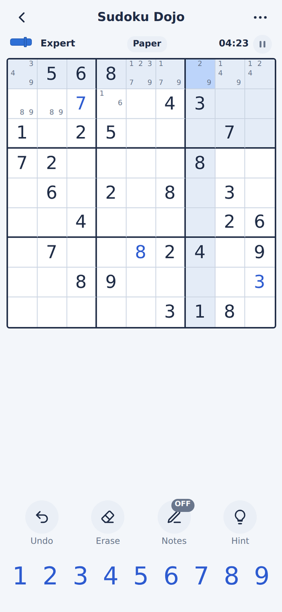
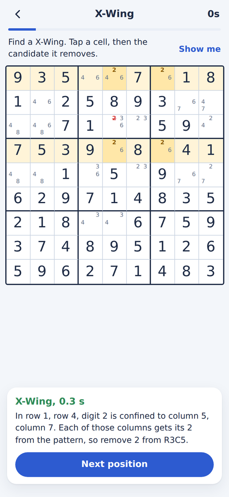
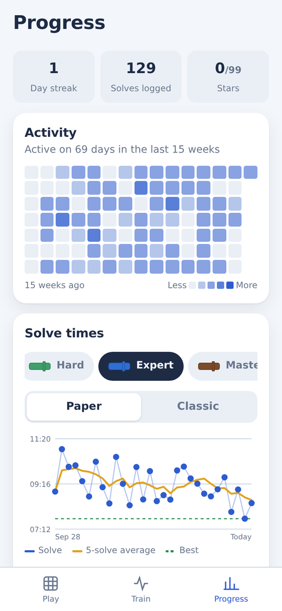

# Sudoku Dojo

Free sudoku with no ads, built for getting faster. Play on "paper", where nothing tells you if a digit is right until the grid is full, and train the exact techniques that slow you down.

**Play now: [thomas-f17.github.io/sudoku-dojo](https://YOUR-USERNAME.github.io/sudoku-dojo/)**

  
  
  

## Install it

It runs in the browser, but works best installed. It then opens full screen, works with no internet connection, and your progress is kept safe.

- **iPhone or iPad:** open the link in **Safari**, tap **Share**, then **Add to Home Screen**. Do this before you start playing: on iPhone, Safari and the Home Screen app keep separate progress, and Safari may clear a site's data if you don't visit for a week or so.
- **Android:** open the link in Chrome, tap **Install** on the card that appears (or menu ⋮ → **Add to Home screen**).
- **Computer:** just play in the browser. In Chrome or Edge you can also install it from the icon in the address bar.

## Playing

Tap a cell, then tap a number. The row, column and box of the selected cell are shaded, and every matching digit is highlighted.

| Button | What it does |
|---|---|
| **Notes** | While on, numbers go in as small pencil marks instead of answers. Tap a number again to remove its mark. |
| **Erase** | Clears the selected cell. |
| **Undo** | Steps back one move. |
| **Hint** | Names the next technique that works, highlights the cells involved and explains it. You can then place the digit or keep going on your own. |
| ⏸ | Pauses and hides the grid. The game also pauses when you leave the app. |
| ⋯ | Puzzle code, restart, settings. |

When you place a digit, it's removed from the notes in its row, column and box automatically (you can turn this off in Settings). A number disappears from the keypad once all nine are on the grid.

On a computer you can use the keyboard: 1–9 to enter, Backspace to erase, N for notes, arrow keys to move, Ctrl/Cmd+Z to undo.

### Paper mode and classic mode

You choose when starting a new game.

- **Paper** (the default): nothing is marked right or wrong while you play, just like a puzzle on paper. When the grid is full it's checked once. If something's wrong you're told how many cells, and can keep solving or ask to see them.
- **Classic:** wrong digits turn red immediately. Three mistakes ends the game, though you can choose to keep going.

### Levels

There are six levels. Each one needs the techniques of the levels below it, plus new ones:

| Level | You'll need |
|---|---|
| Easy | Singles: the only place a digit fits, or the only digit a cell can be |
| Medium | Singles, with fewer starting clues |
| Hard | Pointing and claiming |
| Expert | Pairs and triples |
| Master | X-Wing, Swordfish, XY-Wing, XYZ-Wing |
| Extreme | Simple colouring and XY-chains |

Every puzzle is new: it's created on your device when you press Start, and always has exactly one solution.

### Today's puzzle and puzzle codes

**Today's puzzle** is the same for everyone on a given day, so you can compare times with friends. The level depends on the day: Medium on Mondays, Hard or Expert midweek, Master on Saturdays and Extreme on Sundays.

Every puzzle also has a **code** (⋯ menu, for example `EXP-1A2B3C`). Send it to someone; they enter it under **Play a puzzle code** on the home screen and get the identical grid.

## Training

The **Train** tab has a track for each level, shown as a belt from white to black. Each drill earns up to three stars depending on your speed, and the target times are shown before you start.

- **Find the move:** the board is set up so one particular technique is the only way forward, and you have to spot it. For singles, tap the cell and then its digit. For the advanced techniques the notes are filled in for you: tap a cell, then the candidate the pattern lets you remove. Afterwards the pattern is highlighted and explained. **Show me** reveals the answer if you're stuck, with a time penalty.
- **Cross-hatching:** you get one digit. Tap every cell where it can go right now; new spots open up as you place them.
- **Note accuracy:** one cell pulses. Mark exactly the digits it could still be, then tap **Check**.
- **Sprints:** place as many correct digits as you can before time runs out. Each wrong digit costs 3 seconds. The Extreme "blind sprint" switches off all highlighting.
- **Timed run:** a full puzzle in paper mode against a target time.

Explanations refer to cells by row and column: **R3C5** means row 3, column 5, counting from the top left.

## After each solve

When you finish, **Where the time went** shows your longest pauses, with a small map of where you were on the grid. For each one it tells you whether an easy digit was already available (you just didn't spot it) or a specific technique was needed, with a button to train that technique.

## Tracking your progress

The **Progress** tab shows:

- your day streak and an activity grid of the days you've played or trained
- a chart of your solve times for each level, with your 5-solve average and best time (lower is faster)
- **Where you get stuck**: the kinds of pauses that come up most in your last 30 solves, each with a drill to fix it
- your stars on every training belt and your recent drill scores
- best and average times for every level

Best times only count solves done without hints and without revealing mistakes.

### Moving or backing up your progress

Your progress is stored only on your device; there are no accounts. To keep it safe or move it to another phone or browser, go to **Progress → Save backup**. This saves a small file. On the other device, open the app and choose **Progress → Restore**, then pick that file. Restoring replaces whatever progress was on that device.

## Settings

Found under ⚙ on the home screen or the ⋯ menu during a game:

- **Auto-remove notes** when you place a digit
- **Highlight row, column and box** of the selected cell
- **Highlight matching digits** (and matching notes)
- **Show rule conflicts in paper mode:** turns duplicates in a row, column or box red. Off by default, since paper wouldn't tell you.
- **Show digits left on the keypad**
- **Appearance:** follow your device, or always light or dark

## Privacy

Nothing leaves your device. There are no accounts, ads, analytics or tracking. Puzzles are generated on your phone, so the app works with no connection.

## Support

Sudoku Dojo is free. If it's helped you get faster, there's a **Support the app** button on the Progress tab.
